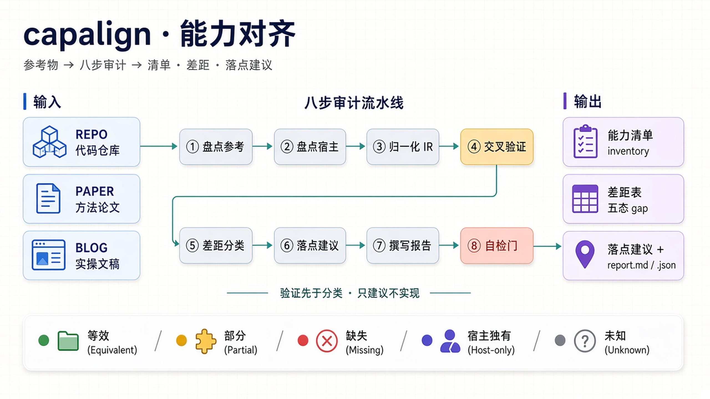
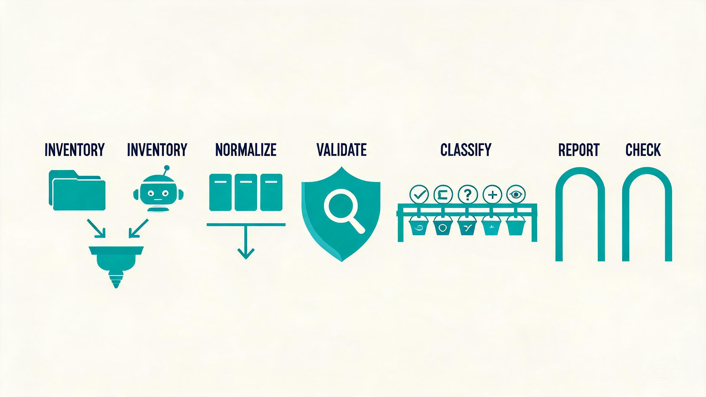
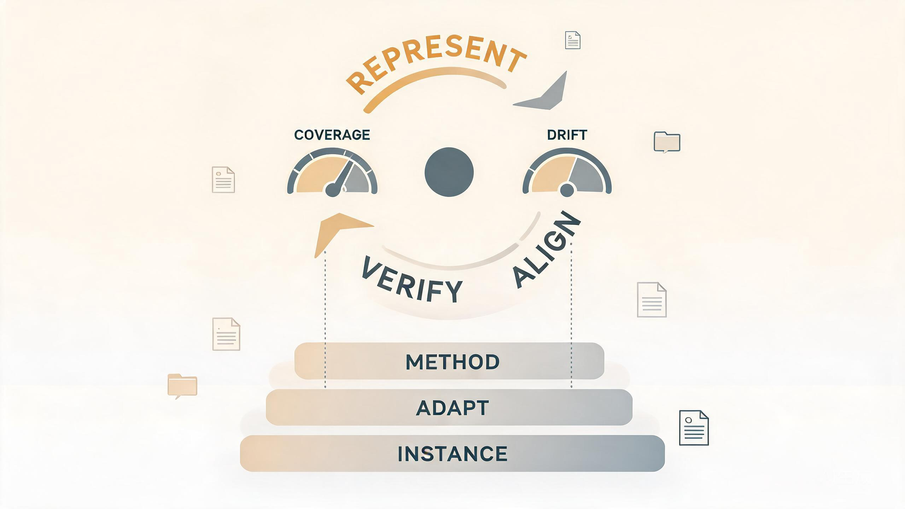
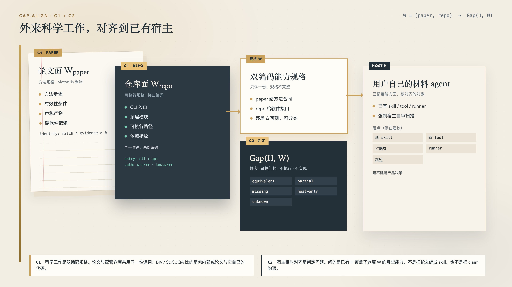
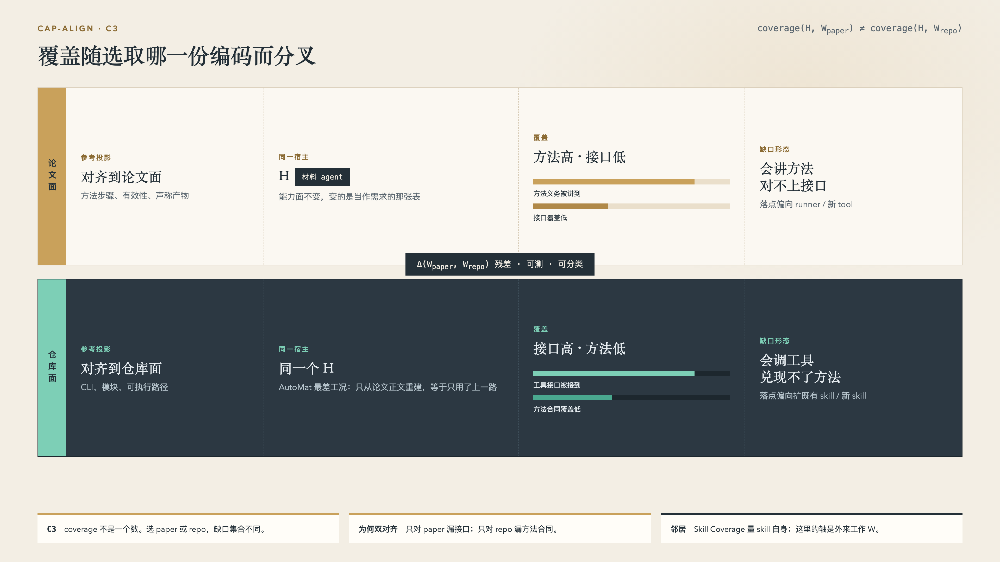

# cap-align — 能力对齐（Capability Alignment）

> **给材料 agent 装上"能力审计"**：把一篇论文（及其配套仓库）的**材料能力**
> 对齐到用户自己的 agent，产出 **能力清单 · 差距表 · 宿主自有的落点建议**。
> 对齐完成 = 宿主自己拥有这些动词，不是把参考 agent 嵌进去。

**框架无关 · 可插拔 · 零捆绑** 的 agent skill。



---

## 这是什么

cap-align 解决一个具体问题：

> 面前有一篇材料论文（通常还有配套仓库），手里有自己的材料 agent。
> **材料模拟（最多到材料 agent 方法）上，我已经有哪些、缺哪些、缺的该落在
> 我自己的能力面上哪一层？** cap-align 把这个问题变成一次可复现的判定，
> 输出三样东西：

1. **能力清单**（inventory）— 参考物"能做什么"、宿主 agent"能做什么"，各一张表
2. **差距表**（gap table）— 五态分类：`equivalent / partial / missing / host-only / unknown`
3. **落点建议**（placement）— 每条差距建议用 `新 skill / 新 tool / 扩既有 / runner 契约 / 跳过` 哪种方式补齐

**设计约束：**

| 约束 | 含义 |
|---|---|
| 框架无关 | 装在任何支持 `SKILL.md` + `references/` 的框架：Claude Code / Anthropic Agent Skills / DeepSeek Harness / Cursor / .agents… |
| 零捆绑 | 不预装脚本与依赖；盘点命令由 agent 用宿主环境现成的 bash / python3 即席执行 |
| 只建议，不实现 | 对齐的终点是推荐；"建不建"是宿主及其人类的产品决策（报告以固定结语声明） |
| 只对齐材料能力 | 核心是能模拟什么；上限是材料 agent 方法（评测势、微调、蒸馏）。plugin / MCP / lockfile / 装环境 不进差距表 |
| 宿主自有 | 落点是宿主自己的 skill/tool/runner；可以调上游科学引擎，不能 wrap 参考 agent |

**它不做什么**：不运行参考工具本身、不替你实现缺口、不把参考 agent 嵌进宿主、不做脱离"能力面"框架的通用摘要。

---

## 能做什么

| 输入 | 输出 |
|---|---|
| **repo** 和/或 **homepage** — 同一工作的仓库与官方文档站 | `capability-alignment-report.md`（核心差距表 + 邻域节 + 落点建议 + 自检块）；先回收配套论文与有界邻域；登记表按一个能力计，不按模型数爆炸 |
| **paper** — 论文文本 | `capability-alignment.json`（IR 机器可读伴侣，与报告同源） |
| **blog** — 博客 / 文稿 | 同上一套；每条能力带原文引文为证 |

**八步工作流**（详见 `SKILL.md`）：

| # | 步骤 | 一句话 |
|---|---|---|
| 1 | 盘点参考物 | repo：本地盘点后按 §E 回收配套论文与有界邻域（主页优先，必要时 web-search）；paper：Methods 拆步骤；blog：声称 + recipe |
| 2 | 盘点宿主面 | 自动扫 skill 目录 / 注册表 + **强制宿主自审扫描** + 扫描不全则询问兜底 |
| 3 | 归一化 | 双侧落进同一能力 IR（typed + evidence 指针 + confidence + source） |
| 4 | 交叉验证 | **验证先于分类**：比对表只是假设，grep 宿主代码、读产物 spec 才是证据 |
| 5 | 分类 + 来源 | 五态差距 × 三来源（宿主自审 / 参考对比 / 领域推断） |
| 6 | 落点 | "落点六问"逐缺口给建议（第五问 never，第六问宿主自有），每条引用规则号 |
| 7 | 报告 | 按报告契约的必需章节组织 |
| 8 | 自检门 | `self_check:` 10 项检查（含邻域分层、宿主自有落点），任一 fail = 整轮无效、回炉 |

---

## 快速开始

**1. 安装 —— 一行命令**

```bash
npx skills add WeiminLee/capalign -g     # 全局安装；或 -p 装到当前项目
```

GitHub 仓库名是 `capalign`（无连字符）。装好后 skill 出现在宿主框架 skills 目录（如 `.agents/skills/capability-align`），适用于 Claude Code / Cursor / Codex / GitHub Copilot 等。想先试用、不落盘：

```bash
npx skills use WeiminLee/capalign@capability-align
```

**手动安装**：也可直接把 `SKILL.md` 与 `references/` 拷入宿主框架的 skills 目录，
或对话中指给 agent。没有依赖要装，没有脚本要跑。

**2. 使用 —— 给 agent 一句话**

```
capability-align <repo 路径 | paper 文本 | blog 文本>
```

例：`capability-align /path/to/phonopy` —— agent 盘点该仓库的能力面，
回收配套论文与有界邻域（主页 / 必要时 web-search），扫描你自身的能力面，
对齐后产出核心差距表、邻域节与落点建议。

**3. 看结果 —— 落在工作区根目录**

```
capability-alignment-report.md   # 人读：清单 / 差距表 / 建议 / 自检块
capability-alignment.json        # 机读：IR 伴侣
```

**4. 验收 —— 装机或改规则后跑一遍 fixture（零捆绑、无测试框架）**

```
1. 盘点：reference = tests/fixtures/mini-ref（mini-paper / mini-blog 同理）
2. 对齐：mini-ref vs mini-host
3. 比对：输出 vs tests/fixtures/gold/*.json，逐条 differ
```

通过标准：与 gold **零未登记差异** + 该次跑 Layer-1 自检全绿。详见 `tests/README.md`。

**研究工具**（承诺漂移测量，纯 stdlib）：

```bash
python3 research/tools/build-registry.py <repo-root> --out reg.json
python3 research/tools/drift-meter.py <skills_dir> --registry reg.json --table
```

---

## 工作原理



| 阶段 | 发生什么 |
|---|---|
| 参考回收 | 给 repo 时：本地种子 → 主页 → 必要时 web-search；核心 \(W\) 与邻域 \(N\) 分层，身份门决定去留 |
| 双盘点 | 参考侧与宿主侧**互不参照**地各建一张能力表——分离是规则，不是方便 |
| 归一化 | 三种知识形态 → 统一 IR：`type（compute/tool/workflow/data/interface/concept）+ evidence + confidence + source` |
| 验证门 | 每个疑缺口先 grep 宿主代码、读产物 spec、查既有部分路径；首跑 ~25 个候选中 grep 干掉 4 个假缺口 |
| 双谓词判定 | 覆盖 = 语义匹配 ∧ 证据强度 ≥ 阈值；`partial` 是严格子集语义；`low` 置信证据永远推不出 `missing` |
| 对齐边界 | 对齐停在宿主已经在回答的问题上：这个数会不会悄悄错。不是参考软件的菜单。另一类问题、另一种计算器或文件格式，不是缺口。诚实拒绝算边界划清；算了别的数却标成这个数，不算 |
| 落点六问 | axis（skill / tool / plugin）→ tool vs script → 新 skill vs 扩既有 → 约束归属 → never → 宿主自有（不 wrap 参考 agent）。一个 skill 是一条 catalog 问法、一份输入、一套「何时不能信」；臃肿是正文里的第二套论证，不是能力条数。tool 做确定性计算或渲染，单消费者后处理留在该 skill 的脚本 |
| 报告 + 自检 | 报告头块 10 项自检（含邻域分层、宿主自有落点）；同输入重跑必须产出相同差距表 |

三个设计纪律（`references/methodology.md`）：

- **三层分离**：通用方法层（零宿主词汇、任何领域可用）→ 可插拔适配层（宿主的
  doctrine、领域词典，按宿主替换）→ 实例层（phonopy↔MatDiscovery 只是验证它的
  第一个证据，不是方法本身）
- **验证先于分类**：比对表是假设，交叉验证才是证据——把假缺口挡在表外
- **消错 > 兑现 > 扩宽**：优先级先修"系统性错的、承诺了却没有的"，再补整类问题，
  最后才上新问题类；优先级判断写进报告，允许被反驳

---

## 为什么可信

**三层防御 + 首轮实证**（都跑在 skill 自己的工作流上，不自造 harness）：

| 防线 | 机制 |
|---|---|
| 交叉验证门 | 分类前强制验证；实例记录：4 个疑似缺口经 grep 证实宿主已具备 → 未进表 |
| Layer-1 自检门 | 每跑强制；任一 fail 即"无效"，不是"基本完成" |
| Layer-2 金标 | 四组 fixture + 手算 gold；gold 修订必须带 `log:` 登记 |

**第一轮实证结果**：

| 实验 | 问的问题 | 结果 |
|---|---|---|
| E1 判卷一致性（IRR） | 五态 × 三来源的判定可复现吗 | P1 κ=**0.853**、P2 κ=**1.000**（pass bar 0.6） |
| E2 三臂装配 | 按报告补 > 随机补 > 不补？ | 协议就绪；下一步拆成按 paper 规格补 vs 按 repo 规格补 |
| EΔ 跨形态残差 | 同一工作的 paper 面 ⋈ repo 面？ | **未跑**（C1/C3 命门） |
| E3 包内漂移 | 声称 vs 已验证（分解项） | K-Dense **30.3%** vs MatDiscovery **11.2%** |
| E4 自参照校准 | 自报面相对外来 \(W\) 可信吗 | mini 实测 bias=0.0、cal(high)=0.75 |



cap-align 是一篇研究论文的测量仪器。「闭环」是仪器形状，不是贡献。
skill 支持 blog 作为第三编码；论文主文钉 paper / repo。

---

## 三点创新

外来科学工作 \(W=(\mathrm{paper},\mathrm{repo})\) 是双编码能力规格；相对已有宿主的
\(\mathrm{Gap}(H,W)\) 是静态、证据门控的判定。覆盖随选取哪一份编码而分叉。



**C1 · 双编码规格。** 论文给方法合同，仓库给软件接口，两份编码共用同一性谓词。
只认其中一份，规格不完整。BIV / SciCoQA 比的是包内部或论文与它自己的代码。

**C2 · 宿主相对判定。** 问的是已有 \(H\) 覆盖了这篇 \(W\) 的哪些能力，不是把论文
编成 skill，也不是把 claim 跑通。输出停在五态差距与落点建议。



**C3 · 参考条件化覆盖。** \(\mathrm{coverage}(H,W_{\mathrm{paper}}) \neq \mathrm{coverage}(H,W_{\mathrm{repo}})\)。
只对 paper 会漏接口，只对 repo 会漏方法合同——这是必须双对齐的测量理由，不是工程便利。

- 论文核心稿（主张 / 创新点 / 差异化定位）：[`docs/paper-core.md`](docs/paper-core.md)
- 形式化定义与可证伪断言 A–E：[`research/formal-foundations.md`](research/formal-foundations.md)
- 实证协议 E1 / EΔ / E2–E4：[`research/experiments.md`](research/experiments.md)
- 项目进展与复现命令：[`docs/progress.md`](docs/progress.md)

---

## 目录结构

```
cap-align/
├── SKILL.md            # skill 本体：八步工作流 + 自检门
├── references/         # 规则与契约：methodology / IR / alignment / inventory / evaluation / report
├── tests/              # 验收 fixtures：mini-ref / mini-host / mini-paper / mini-blog + gold 金标
├── research/           # 论文与实证：formal-foundations / experiments / runs / tools
├── docs/               # 论文核心稿 + 项目介绍 + 图（figures/ 正稿 · images/ 概念渲染）
└── README.md
```

## 诚实边界（不做假装）

- E1 κ 仍为**同模型三 judge** 的下限信号——人类 / 第二模型 judge 未到位，真 IRR 未达成；
- EΔ（同一工作的 paper 面 ⋈ repo 面）尚未开跑——C1/C3 的命门；
- E2 真实层数值 gold 依赖 phonopy 可执行安装，当前为 pending；按 paper 规格补 vs 按 repo 规格补尚未拆臂；
- 需求侧 `coverage(H,W)` 分布未立；已测的是 2 个库的包内 drift（分解项）；
- 断言 E（stale-skill 召回）需要纵向 git 历史，尚未开跑。
